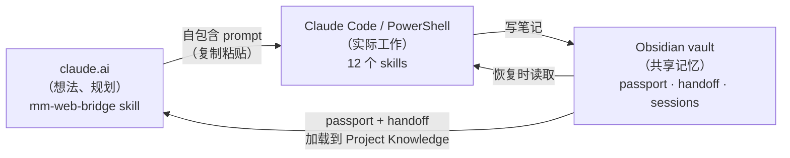

# markdown-memory

> 一个文件驱动的记忆和 prompt 桥接系统，连接 claude.ai（思考的地方）↔ Claude Code（干活的地方）↔ Obsidian（共享长期记忆）。


- **一句话**：文件驱动的记忆系统，打通 claude.ai、Claude Code 和 Obsidian。
- **适合谁**：在 claude.ai 想点子、在 Claude Code 干活、受够上下文蒸发的人。
- **不适合谁**：只用一个工具、不需要跨会话记忆的。

## 为什么做这个

用 Claude 干活的人都有这个体验：你在 **claude.ai** 上聊想法、做规划，然后切换到 **Claude Code** 在终端里写代码。两边不共享记忆，会话之间上下文蒸发，聊天窗口一关，刚才想到的东西就没了。

**mm** 就是来填这个坑的。它是一套 [Claude Agent Skills](https://docs.claude.com/en/docs/agents-and-tools/agent-skills/overview) 加一个小 PowerShell 安装器，给你：

- **一个共享记忆**：每个项目一份，以纯 markdown 存在 Obsidian vault 里（passport、handoff、session 历史）
- **一个 prompt 桥**：在 claude.ai 上想好的点子变成干净、自包含的任务，直接贴进 Claude Code
- **一个简单的生命周期**：开始项目、恢复项目、保存会话、跨聊天交接——不用每次都复制粘贴整个历史

一切都是 markdown 和文件。没有数据库，没有云，没有锁定。

## 工作原理

mm 横跨三个环境，通过文件共享状态，不靠魔法：



- **claude.ai 侧** 是单个 skill（`mm-web-bridge`）：它挑战你的想法、对照实时网络检查快速变化的技术，然后组合你要在 Claude Code 里运行的 prompt
- **Claude Code 侧** 是 `mm` 调度器 + 11 个 `mm-*` skill，负责干活并保持 vault 更新
- **Obsidian** 只是 markdown 存放的文件夹。Obsidian 帮你索引；mm 直接读写文件

## 快速开始

### 前置要求

- [Claude Code](https://docs.claude.com/en/docs/claude-code) CLI
- Python 3（macOS/Windows 默认已装）
- Node.js（v16+ 用于 `npx` 安装器）
- 一个 Obsidian vault（任何文件夹都行；Obsidian 本身可选但推荐）

### NPM / npx 安装（推荐）

跨 **Windows、macOS、Linux** 安装和配置整个系统的最简单方式：

```bash
npx markdown-memory
```

这个命令会：
1. 把仓库克隆到 `~/.markdown-memory/`（已克隆则更新）
2. 在 shell 配置文件（Mac/Linux 的 `.zshrc` / `.bashrc`）或 Windows 注册表中设置 `MM_REPO_ROOT` 环境变量
3. 自动注册所有 skill（Windows 上创建 NTFS junction，macOS/Linux 上创建符号链接）到 `~/.claude/skills/`

要更新 skill 和代码库，随时再跑一次 `npx markdown-memory`（或在 agent 会话里跑 `/mm update`）。

### 手动安装（备选）

```bash
# 1. 克隆仓库
git clone https://github.com/mworldorg/markdown-memory.git
cd markdown-memory

# 2. 注册 skill：
# Windows（PowerShell）：
powershell scripts/register-skills.ps1
# macOS / Linux（或 Windows 上用 Python）：
python3 scripts/register-skills.py
```

### 安装后设置

1. **个性化**：重启 Claude Code（skill 在会话开始时加载），然后运行：
   ```bash
   /mm setup
   ```
2. **创建 Passport**：进入你的项目文件夹，初始化：
   ```bash
   /mm new
   ```

### 连接 claude.ai 侧

1. 在 claude.ai 上为你的工作创建一个 Project
2. 把项目的 `passport.md` 和 `handoff.md` 加到 **Project Knowledge**
3. 把 `mm-web-bridge` skill 加载到那个 Project（claude.ai → Customize → Skills → Upload a skill）。`/mm setup` 之后，上传你个性化后的副本，路径在 `claude-ai-skills/_generated/mm-web-bridge/`——仓库里提交的 `claude-ai-skills/mm-web-bridge/` 是带占位符 persona 的模板
4. 新聊天的第一条消息：
   > *"Read handoff.md and passport.md, tell me where we are and suggest the next step."*

### 循环

```text
/mm resume   →   在 claude.ai 讨论   →   把 prompt 贴进 Claude Code   →   /mm save   →   /mm next
```

**在 GSD 项目上**，当你完成一个阶段想要干净上下文时，运行 `/clear` 然后 [`/mm-focus`](skills/mm-focus/SKILL.md)，而不是裸 `/clear`——`mm-focus` 会把当前阶段的文件（STATE + CONTEXT/PLAN/SUMMARY）重新加载到新鲜上下文里，让你不丢失位置继续。

## Skills

Claude Code 侧 12 个 skill，claude.ai 侧 1 个，外加 vendored 的外部 skill（见[集成](#integrations)）。

| Skill | 功能 |
|---|---|
| `mm` | 调度器——下面所有功能的短别名 |
| `mm setup` | 克隆后的一次性个性化 |
| `mm-init-project` | 在 vault 里创建项目 passport + 结构 |
| `mm-resume` | 启动时加载 passport + 仪表板 + 上次会话 |
| `mm-projects` | 所有项目的单屏概览（只读） |
| `mm-bridge` | 把任务包装成 Claude Code 的 prompt 框架 |
| `mm-handoff` | 生成跨聊天交接摘要 |
| `mm-save-session` | 把决策和进展捕获到 vault |
| `mm-instructions` | 管理项目指令 |
| `mm-doctor` | 健康检查、版本同步、与 passport 的一致性 |
| `mm-update` | 从 git 远程自更新 mm（fetch、changelog、确认、ff-only pull、重新注册） |
| `mm-vault` | 为项目的记忆 vault 引导私有 git 仓库，同步到 claude.ai Knowledge（memory-sync） |
| `mm-web-bridge` *(claude.ai)* | 浏览器里的想法伙伴 + prompt 组合器 |
| `ecc-security-review` *(vendored — [ECC](https://github.com/affaan-m/everything-claude-code), MIT)* | 安全检查清单：密钥、输入验证、SQLi、认证、XSS/CSRF、限流 |
| `ecc-search-first` *(vendored — [ECC](https://github.com/affaan-m/everything-claude-code), MIT)* | 编码前研究：搜索现有工具/库/MCP/skill，然后采用/扩展/构建 |

## MCP 工具

mm 附带一个小的本地 **stdio** MCP 服务器（`mm-mcp`，TypeScript），向本地 agent（Claude Code / Desktop / Antigravity）暴露两个确定性、只读的工具：

- `mm_secret_scan`——对照规范的 `config/secret-patterns.json` 扫描文本中的密钥；只返回类别和计数，从不返回原始密钥值
- `mm_health`——mm 安装的只读健康检查（配置、junction、vault-git、passport/gsd）；返回 `checks[]` + `summary`

构建、注册（`claude mcp add … mm-mcp …`）、范围和测试见 [`mcp/README.md`](mcp/README.md)。

## 集成

mm 与几个外部工具和工作体系协作。凡是在他人项目基础上构建的，该项目保留自己的许可证和归属。

- **GSD**——基于阶段的规划框架。mm **读取** GSD 状态（`.planning/` / `.gsd/`）并与之协作；从不写入。（最深入的集成）
- **Karpathy guidelines**——四个元原则（编码前思考、简单优先、外科手术式修改、目标驱动），应用于 Claude Code 和 claude.ai 两侧。MIT。（外部 Claude Code 插件——单独安装，见下方可选插件）
- **[context-mode](https://github.com/mksglu/context-mode)**——会话内上下文优化和连续性。见[记忆层](#two-memory-layers)了解它与 mm 的关系。Elastic License 2.0（源码可用）。（外部 Claude Code 插件——单独安装）
- **prompt-frameworks**——`mm-bridge` 使用的 CRISPE / XML / PERSONA / HYPOTHESIS 模板。灵感来自 [awesome-claude-prompts](https://github.com/langgptai/awesome-claude-prompts)，MIT。
- **[claude-code-telegram](https://github.com/RichardAtCT/claude-code-telegram)**——可选的 Telegram 桥，默认关闭。MIT。
- **Telegram 集成（UI/UX 和会话）**——自动检测 Telegram bot 和 Telethon 项目，复制安全会话指南和 UI/UX 标准，注入约束到 passport，并通过 `/mm check`（`mm-doctor`）自动验证 Python 代码库中的易被封和 UX bug（可通过 passport 中的 `telegram_ui_ux: false` 禁用）。详见 [docs/TELEGRAM-INTEGRATION.md](docs/TELEGRAM-INTEGRATION.md)。（内置）
- **[ECC — everything-claude-code](https://github.com/affaan-m/everything-claude-code)**——两个 skill 按件 vendored 到 `vendor/`：`ecc-security-review`（markdown 安全检查清单；重命名以避免与内置 `/security-review` 冲突）和 `ecc-search-first`（编码前研究工作流）。ECC 的其余部分（AgentShield、插件、hooks、约 246 个 skill）**未**包含。MIT © Affaan Mustafa。（按 skill vendoring 机制——见 [`vendor/README.md`](vendor/README.md)）

### 两层记忆

mm 和 context-mode 解决**不同**的问题，不重叠：

- **context-mode** 保持*单个会话*存活——它通过重建 Claude Code 内的工作状态来抵御 auto-compaction 和 `--resume`
- **mm** 保持*长期项目历史*——跨会话、跨聊天的决策、交接和会话笔记，存在 Obsidian vault 里

如果你两个都用，context-mode 已经处理了 compaction；mm 不会重复做。

### 可选插件

Karpathy guidelines 和 context-mode 是外部 Claude Code 插件（不在此仓库捆绑）。mm 与它们协作但没有它们也能工作。安装：

```text
# Karpathy 编码指南（编码前思考、简单、外科手术、目标驱动）
/plugin marketplace add forrestchang/andrej-karpathy-skills
/plugin install andrej-karpathy-skills@karpathy-skills

# context-mode（会话内上下文优化 + 跨 compaction 连续性）
/plugin marketplace add mksglu/context-mode
/plugin install context-mode@context-mode
```

## 记忆同步（claude.ai Knowledge 通过 git）

自动同步 Obsidian 项目记忆（passport、handoff、sessions）到 claude.ai 网页界面，通过 GitHub 上的私有 git 仓库。完整设置和使用指南见 [`docs/memory-sync.md`](docs/memory-sync.md)。

## 跨平台

mm 是跨平台的！完全支持 Windows、macOS 和 Linux：
- **Windows**：用 `powershell scripts/register-skills.ps1` 或 `python3 scripts/register-skills.py`
- **macOS / Linux**：用 `python3 scripts/register-skills.py`（在 `~/.claude/skills` 设置符号链接，并在 shell 配置文件如 `.zshrc` 或 `.bashrc` 中导出 `MM_REPO_ROOT`）

可选的 Telegram 桥：
- **Windows**：`powershell scripts/install-tg-bridge.ps1`
- **macOS / Linux**：`python3 scripts/install-tg-bridge.py`

## 约定

- **个人数据永不进入提交文件。** 你的名字和路径存在 gitignored 的 `mm-config.local.json` 里，由 `/mm setup` 写入。提交的配置保持通用模板。
- **版本单一事实来源**——`config.version`。每个 skill 的 `version:` 字段有意保持粒度。
- **Skills 写入前预览**，且从不写入 GSD 的 `.planning/` / `.gsd/`。

## 文档

- [`passport.md`](templates/passport.md)——每个项目的事实来源（架构、约定、约束）
- [`docs/memory-sync.md`](docs/memory-sync.md)——通过 Git 自动同步 claude.ai Project Knowledge 的分步指南（推荐）
- [`docs/MCP-INTEGRATION.md`](docs/MCP-INTEGRATION.md)——通过 Model Context Protocol（MCP）连接 Obsidian Vault 的分步指南（推荐）
- [`docs/TELEGRAM-INTEGRATION.md`](docs/TELEGRAM-INTEGRATION.md)——Telegram 项目自动集成会话安全规则和 UI/UX 设计标准的指南（推荐）
- [`docs/`](docs/)——更深入指南（Telegram 桥、配置加载等）

## 贡献

欢迎 Issue 和 PR。新 skill 放在 `skills/your-skill/SKILL.md`，带 YAML frontmatter；claude.ai skill 放在 `claude-ai-skills/`（它们**不会**被 junction 到 Claude Code）。

## 同生态项目

- [obsidian-second-brain](https://github.com/2233admin/obsidian-second-brain) — 会自己改写的 Obsidian vault
- [obsidian-vault-bridge](https://github.com/2233admin/obsidian-vault-bridge) — 把 vault 变成 MCP 服务器
- [voile](https://github.com/2233admin/voile) — 聊天记录编译成 Obsidian 知识
- [design-pipeline](https://github.com/2233admin/design-pipeline) — 给 AI Agent 的前端设计管线
- [repowise](https://github.com/2233admin/repowise) — AI Agent 的代码库智能层

## License

MIT——见 [LICENSE](LICENSE)。集成项目保留自己的许可证（见[集成](#integrations)）。
